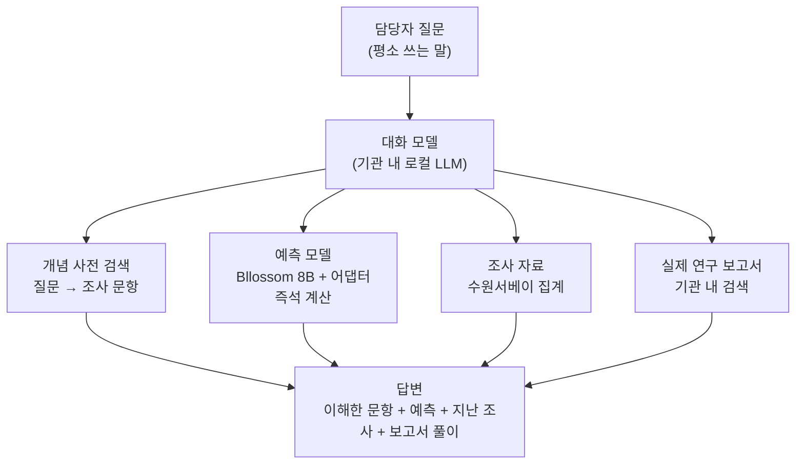

# 수원서베이 응답 예측 챗봇 소개

이 문서는 이 챗봇을 처음 보는 분을 위한 소개입니다. 무엇을 보여 주는 화면인지, 질문 하나가 어떻게 처리되는지, 원래는 어떤 구조가 바람직하고 지금은 어떻게 만들어 두었는지, 그리고 어떻게 실행하는지를 차례로 적었습니다. 설치 명령과 설정값 같은 세부 사항은 [README](../README.md)에 있습니다.

## 1. 한마디로

수원시청이나 수원시정연구원의 담당자가 **평소 쓰는 말로** 물으면, **수원서베이로 학습한 로컬 AI**가 아직 하지 않은 조사의 응답을 미리 가늠하고, 지난 조사 결과와 연구 보고서로 풀이해 주는 **시연용 화면**입니다.

보여 주려는 것은 하나입니다. 성능 좋은 범용 AI라도 **우리 조사 자료, 그 자료로 학습한 예측 모델, 조사 개념과 보고서를 찾아 주는 검색(RAG)** 없이는 이런 질문에 답하지 못한다는 것입니다. 쓸모는 큰 범용 모델이 아니라 기관 안에 있는 자료와 그것을 다루는 장치에서 나옵니다.

실제로 운영하는 서비스가 아닙니다. 실험 결과를 표와 숫자로만 보면 와닿지 않으므로, 질문하고 답을 받는 형태로 보여 주려는 것입니다.

## 2. 이 시연의 설정: 2025년 조사는 아직 하지 않았다

이 화면은 **2025년 수원서베이를 아직 하지 않았다고 놓습니다.** 담당자가 "이번 조사에서 시민들은 어떻게 답할까?"를 조사 전에 미리 가늠해 보는 상황입니다.

- 답변과 결과 카드는 **2025년 예측**과 **지난 조사(2023·2024년) 결과**만 보여 줍니다.
- 2025년 실제 조사 결과는 이 AI를 만들 때 **가려 두었다가 맞혀 보는 데 쓴 검증용 값**입니다. 결과 카드의 **검증 보기**를 누르거나, "이 예측을 믿어도 돼?"처럼 신뢰도를 물을 때만 나옵니다.

## 3. 바탕이 된 실험

- **무엇을 학습했나**: 한국어 언어 모델(Bllossom 8B)에 2023년과 2024년 수원서베이의 집단별 응답 결과를 학습시켰습니다. 모델 전체를 바꾸지 않고 **어댑터**라는 작은 부품만 학습시켜 원래 모델에 끼우는 방식입니다.
- **무엇을 예측하나**: 2025년 문항 113개에 각 집단이 어떻게 답할지입니다. 2025년 조사 결과는 학습에 쓰지 않았습니다.
- **예측의 모양**: "평균 몇 점" 하나가 아니라 **응답 분포**, 곧 보기마다 몇 %가 고를지입니다.
- **집단**: 성별, 연령, 주택유형, 점유형태, 고용형태, 통근·통학, 거주기간, 종교의 여덟 속성으로 나눈 33개 집단입니다. 한 번에 속성 하나로만 나눕니다.

### 예시 하나

질문: "월세 사는 사람들은 자기 형편을 어떻게 느낄까?"

AI는 이 질문을 **본인의 경제·사회적 위치** 문항("한국사회의 최하층을 0으로 하고 최상층을 10으로 한다면 귀하는 본인의 경제·사회적 위치가 어디에 해당된다고 생각하십니까?")으로 이해하고, 점유형태별로 봅니다.

| 집단 | 2025년 예측 평균 | 2023년 조사 | 2024년 조사 |
|---|---|---|---|
| 자가 | 5.47점 | 4.94점 | 5.75점 |
| 전세 | 5.41점 | 4.63점 | 5.34점 |
| 월세 및 사글세 | 5.17점 | 3.82점 | 4.27점 |

답변은 이 예측에 더해, 참고 보고서가 2023·2024년 조사에서 "자가가 가장 높고 월세 및 사글세가 가장 낮았다"고 정리한 내용을 인용해 풀이합니다.

**검증**(가려 두었던 2025년 결과와 견줌): 실제 평균은 자가 5.89점, 전세 5.69점, 월세 및 사글세 5.04점이었습니다. 분포 전체로 잰 오차는 11점 척도에서 약 0.36점입니다. 작년(2024년) 결과를 그대로 썼다면 약 0.44점, 수원서베이를 학습하지 않은 원래 모델은 약 2.7점 어긋났습니다. 예측은 집단 사이의 차이를 실제보다 작게 잡는 편입니다.

### 어댑터 세 개

같은 모델에 서로 다르게 학습시킨 어댑터 세 개가 있습니다. 시연에서는 아래 상황을 보여 주는 데 씁니다.

| 어댑터 | 학습 자료 | 시연에서 보여 주는 상황 |
|---|---|---|
| 전체 학습 어댑터 | 2023·2024년 전체 | 다음 조사의 응답을 미리 가늠하기 |
| 집단 제외 어댑터 | 7개 집단의 응답을 뺀 것 | 응답을 받지 못한(조사에서 빠진) 집단도 예측하기 |
| 문항 제외 어댑터 | 4개 문항을 뺀 것 | 처음 조사하는 문항도 예측하기 |

## 4. 질문 하나가 처리되는 과정

"월세 사는 사람들은 자기 형편을 어떻게 느낄까?"라고 물으면 다음이 차례로 일어납니다.

1. **질문 이해 (개념 사전 검색)**: "형편"처럼 조사표에 없는 말을 조사 개념과 이어, 맞는 문항(경제·사회적 위치)과 집단 구분(점유형태)을 찾습니다.
2. **예측 가져오기**: 그 문항·집단의 2025년 예측 분포를 가져옵니다.
3. **지난 조사와 참고 문서 찾기**: 같은 문항의 2023·2024년 결과와, 그 문항을 다룬 보고서를 찾습니다.
4. **답변**: 이 순서로 씁니다. 어떻게 이해했는지 → 무엇을 묻는 문항인지(정의) → 예측 → 지난 조사 → 보고서를 인용한 풀이.

여기에는 서로 다른 일을 하는 부품이 있습니다. 이 구분이 이 챗봇을 이해하는 핵심입니다.

| 부품 | 하는 일 | 하지 않는 일 |
|---|---|---|
| 예측 모델 (Bllossom 8B + 어댑터) | 응답 분포를 예측한다 | 문장을 쓰지 않는다. 보고서를 보지 않는다 |
| 조사 자료 (수원서베이 집계) | 지난 조사 결과를 준다. 2025년 결과는 검증에만 쓴다 | — |
| 개념 사전 | 일상어 질문을 조사 개념과 문항에 잇는다 | 예측에 쓰이지 않는다 |
| 참고 문서 | 수치를 풀이할 근거가 된다 | 예측에 쓰이지 않는다 |
| 대화 모델 | 질문을 받아 위 부품을 부르고 답변 문장을 쓴다 | 숫자를 스스로 계산하지 않는다. 앱이 준 숫자를 옮기도록 지시되어 있다 |

차트의 숫자는 대화 모델을 거치지 않고 화면에 바로 갑니다. 문장과 차트가 다르면 차트가 맞습니다.

## 5. 질문 이해와 검색(RAG)

담당자는 조사표 문구로 묻지 않습니다. "형편", "워라밸", "시청을 믿을까"처럼 묻습니다. 이 말을 맞는 문항에 잇는 것이 **개념 사전**(`concepts/개념사전.md`)입니다. 문항마다 조사가 재는 개념, 그 정의, 담당자가 쓸 법한 일상 표현을 적어 두고, 질문과 뜻이 가까운 문항을 찾습니다(로컬 임베딩 검색).

담당자식 질문 40개로 쟀더니 1순위 후보가 정답인 비율이 이렇게 달랐습니다.

| 문항 찾는 방법 | 첫 묶음 20개 | 둘째 묶음 20개 |
|---|---|---|
| 단어 검색 (질문과 글자가 겹치는 문항) | 8 | 8 |
| 개념 사전 검색 | 16 | 19 |

둘째 묶음은 개념 사전을 보지 않은 별도 작성자가 만든 질문입니다. 측정은 `scripts/eval_question_search.py`로 다시 돌려 볼 수 있습니다.

작은 로컬 모델은 문항 113개(연도까지 합치면 수백 개)의 목록을 한 번에 받아 판단하기 어렵습니다. 그래서 이 챗봇은 대화 모델에 문항 목록을 주지 않고, 문항을 반드시 검색으로 찾게 해 두었습니다. 로컬 모델이 처한 조건과 같게 하려는 것입니다.

화면에서는 두 가지로 이 차이를 보여 줍니다.

- **질문 이해 칸**: 답변 위에, 같은 질문을 단어 검색과 개념 사전 검색으로 각각 찾은 문항 후보를 나란히 보여 줍니다. 예를 들어 "시민들이 시청을 얼마나 믿을까?"에서 단어 검색은 버스 문항을, 개념 사전 검색은 공공기관 신뢰 문항을 찾습니다.
- **비교해서 보기**: 같은 질문을 "일반 AI"(질문만 받음)나 "RAG 없음"(조사 데이터와 단어 검색만)으로도 받아 평소 답변 옆 칸에 함께 띄웁니다.

## 6. 이상적인 구조

실제로 기관에서 쓴다면 모든 부품이 **기관 안의 장비**에서 돌고, 예측은 **질문을 받을 때마다 즉석에서** 계산하는 것이 바람직합니다.



- **예측 모델**이 기관 서버에 올라가 있어, 어떤 문항·집단이든 그 자리에서 계산합니다. 조사에 없던 **새 문항**을 넣어 "이렇게 물으면 어떻게 답할까"를 미리 보는 데까지 쓸 수 있습니다.
- **대화 모델**도 기관 안의 로컬 LLM입니다. 질문과 자료가 밖으로 나가지 않고, 이용료가 들지 않습니다.
- **개념 사전과 참고 문서**는 기관이 직접 관리합니다. 참고 문서는 연구원이 실제로 낸 보고서이고, 답변이 해당 쪽을 인용합니다.

## 7. 지금 만들어 둔 구조

시연은 GPU가 없는 노트북 한 대로도 할 수 있어야 하므로, 일부 부품을 대역으로 바꿔 두었습니다. 화면과 질문·답변의 흐름은 이상적인 구조와 같습니다.

| 부품 | 이상적인 구조 | 지금 | 까닭과 결과 |
|---|---|---|---|
| 예측 모델 | 기관 서버에서 즉석 계산 | 연구실 GPU 서버에서 **미리 계산해 둔 예측**을 꺼낸다 | GPU 없이 바로 답이 나오고, 실험 결과의 숫자와 똑같다. 대신 미리 계산한 113개 문항만 볼 수 있다 |
| 대화 모델 | 기관 안의 로컬 LLM | 시연 속도를 위해 외부 대화 모델을 대역으로 쓴다 | 인터넷과 이용 키가 필요하다. 모델은 `.env`의 `CHAT_MODEL`로 바꾼다 |
| 개념 사전 검색 | 기관 안에서 검색 | 같다 (노트북 안에서 검색) | 사전은 조사표 문구로 만든 초안이다 |
| 참고 문서 | 실제 연구 보고서 | **시연용 가상 보고서** 12편 | 구조를 보여 주기 위한 대역이다. 숫자는 2023·2024년 수원서베이 실제 결과에서만 가져왔고 글은 시연용으로 지었다. 화면에 "시연용 가상 문서"라고 표시된다 |
| 조사 자료 | 수원서베이 집계 | 같다 | 집단별 집계만 들어 있다. 개인 단위 응답은 없다 |

덧붙여 둔 장치가 셋 있습니다.

- **인터넷이 끊겨도 시연이 이어지게**: 대화 모델에 닿지 않으면, 처음 화면의 추천 질문은 미리 받아 둔 답변으로 나옵니다. 화면에 "저장된 답변"이라고 표시됩니다. 차트와 참고 문서는 그대로 나옵니다.
- **대화 기록**: 왼쪽에서 지난 대화를 다시 열거나 새 대화를 시작할 수 있습니다. 기록은 서버 메모리에만 있어서 서버를 끄면 사라집니다.
- **즉석 계산도 해 볼 수 있게**: 아래 8절의 두 번째·세 번째 방식입니다.

## 8. 실행 방식

예측을 어디서 가져오느냐에 따라 세 가지 방식이 있고, 설정값 하나(`PREDICT_BACKEND`)로 고릅니다. 화면과 대화는 셋 다 같습니다.

| 방식 | 예측을 가져오는 곳 | 필요한 장비 | 화면 표시 | 언제 쓰나 |
|---|---|---|---|---|
| **조회** (`lookup`, 기본) | 미리 계산해 둔 값 | 보통 노트북 | 사전 계산 | 시연과 발표 |
| **실시간** (`live`) | GPU에서 모델을 올려 즉석 계산 | GPU 메모리 16GB 이상 | 실시간 | 이상적인 구조를 그대로 돌려 볼 때. 새 문항 예측 |
| **실시간 · 양자화** (`gguf`) | 모델을 작게 줄여 CPU에서 즉석 계산 | GPU 없이 RAM 8GB 이상 | 실시간 · 양자화 | GPU 없는 PC에서 즉석 계산의 흐름만 돌려 볼 때 |

세 방식의 현재 상태는 다음과 같습니다.

- **조회**: 화면의 모든 값이 실험 결과 원본과 일치하는 것을 확인했습니다. 시연에는 이 방식을 씁니다.
- **실시간**: 만든 PC에 GPU가 없어 **실제 모델로는 아직 돌려 보지 못했습니다.** GPU가 있는 PC에서 점검 프로그램(`live_check`)을 돌려 저장된 예측과 같은 값이 나오는지 먼저 확인해야 합니다.
- **실시간 · 양자화**: GPU 없는 PC에서 실제로 돌아갑니다. 한 장면을 처음 볼 때 집단 수에 따라 40초에서 1분 반쯤 걸립니다. 다만 **값이 저장된 예측과 꽤 다릅니다.** 숫자를 믿고 볼 용도가 아니라 흐름을 보는 용도입니다. RAM이 8GB 언저리인 PC에서는 다른 프로그램과 함께 돌리면 메모리가 모자랄 수 있습니다.

### 가장 간단한 실행 (조회 방식)

Python 3.12와 Node가 깔린 PC에서 저장소를 받은 뒤 아래를 차례로 실행합니다.

```bash
pip install -r requirements.txt          # 필요한 파이썬 패키지
cp .env.example .env                     # 대화 모델 이용 키를 적는 파일 (키가 없어도 추천 질문은 나온다)

cd backend
python -m suwon_chat.build_index         # 예측과 조사 자료를 정리한다 (처음 한 번)
python -m suwon_chat.reports             # 참고 문서를 검색할 수 있게 정리한다 (처음 한 번. 검색용 모델 약 470MB를 내려받는다)
python -m suwon_chat.concepts            # 개념 사전으로 문항을 찾을 수 있게 정리한다 (처음 한 번)

cd ../frontend
npm install && npm run build             # 화면을 만든다 (처음 한 번)

cd ../backend
python -m uvicorn suwon_chat.api:app --port 8000
```

브라우저에서 http://localhost:8000 을 열고, 처음 화면의 추천 질문을 차례로 눌러 보면 됩니다.

| 추천 질문 | 보여 주는 것 |
|---|---|
| 담당자처럼 묻기 · 형편 | 조사표 문구 없이 물어도 맞는 문항을 찾고, 예측하고, 지난 조사와 보고서로 풀이한다 |
| 담당자처럼 묻기 · 시청 신뢰 | 질문 이해 칸에서 단어 검색과 개념 사전 검색이 다른 문항을 찾는 것이 보인다 |
| 이 예측을 믿어도 될까 | 2025년 조사를 가려 두고 맞혀 본 검증 결과. 작년 결과를 그대로 쓰는 것보다 나았나 |
| 조사에서 빠진 집단 | 한 집단의 응답 없이 학습해도 그 집단을 예측한다 |
| 처음 묻는 문항 | 한 번도 학습하지 않은 문항을 처음 조사한다고 치고 예측한다 |
| 할 수 없는 것 | 할 수 없는 질문에 지어내지 않고 할 수 없다고 답한다 |

앞의 두 질문은 입력창 위의 **비교해서 보기**를 "일반 AI와"로 켜고 눌러 보면, 범용 AI의 답과 나란히 볼 수 있습니다.

실시간 방식과 양자화 방식의 실행 순서, 장비별 주의점은 [README의 "예측을 가져오는 세 가지 방식"](../README.md#예측을-가져오는-세-가지-방식)에 있습니다.

## 9. 할 수 있는 것과 없는 것

할 수 있는 것:

- 평소 쓰는 말로 묻고, 어떤 문항으로 이해했는지 확인하기
- 2025년 조사 문항 113개에 대해, 여덟 속성 가운데 하나로 나눈 집단별 예측을 지난 조사와 함께 보기
- 관련 참고 문서를 찾고, 그 내용으로 수치를 풀이하기
- 예측을 얼마나 믿을 수 있는지 검증 결과로 확인하기 (가려 두었던 2025년 결과, 작년 결과를 그대로 쓴 경우, 학습하지 않은 모델과 견주기)
- 같은 질문을 일반 AI나 RAG 없는 경우와 나란히 견주기
- (실시간 방식과 양자화 방식에서) 조사에 없던 새 문항의 예측. 견줄 결과가 없으므로 "실험적"이라고 표시된다

할 수 없는 것. 물으면 할 수 없다고 답합니다.

- 두 속성을 겹친 집단 ("30대 여성")
- 연도에 따른 변화나 추세 ("앞으로 계속 오를까?"). 이 모델은 다음 조사의 응답 분포를 그려 볼 뿐, 연도 정보를 쓰지 않는다
- 모델이 왜 그렇게 예측했는지에 대한 설명

개인 단위 응답은 애초에 들어 있지 않습니다. 이 챗봇이 가진 조사 자료는 집단별 집계뿐입니다.

## 10. 용어

| 용어 | 뜻 |
|---|---|
| 응답 분포 | 한 문항에서 보기마다 몇 %가 골랐는지. 이 모델이 예측하는 대상 |
| 지난 조사 | 2023·2024년 수원서베이의 집단별 결과. 예측과 나란히 보여 주는 참고 값이다. 모델이 이 숫자를 보고 계산하는 것은 아니다 |
| 검증 | 2025년 조사 결과를 학습에서 가려 두었다가, 예측이 얼마나 맞았는지 견줘 보는 것. 결과 카드의 "검증 보기"에서 본다 |
| 오차 | 예측 분포와 실제 분포가 얼마나 다른지. 화면에서는 "11점 척도에서 약 0.36점"처럼 척도의 점수로 바꿔 보여 준다 |
| 어댑터 (LoRA) | 큰 모델은 그대로 두고 따로 학습시켜 끼우는 작은 부품. 갈아 끼우면 같은 모델이 다르게 학습된 것처럼 움직인다 |
| 학습하지 않은 모델 | 어댑터를 끼우지 않은 원래 Bllossom 8B. 학습의 효과를 보기 위한 비교 대상 |
| 개념 사전 | 문항마다 조사 개념의 정의와 일상 표현을 적은 문서. 질문을 맞는 문항에 잇는 검색에 쓴다 |
| RAG | 답하기 전에 필요한 자료(여기서는 개념 사전과 참고 문서)를 검색해 근거로 쓰는 방식 |
| 대화 모델 | 질문을 받아 부품을 부르고 답변 문장을 쓰는 모델. 예측 모델과는 다른 모델이다 |
| 양자화 | 모델의 숫자를 거칠게 줄여 용량을 작게 만드는 것. 작은 장비에서 돌지만 값이 달라질 수 있다 |
| 사전 계산 · 실시간 | 예측을 미리 계산해 둔 것인지, 질문을 받고 계산한 것인지. 화면의 배지로 구분한다 |
