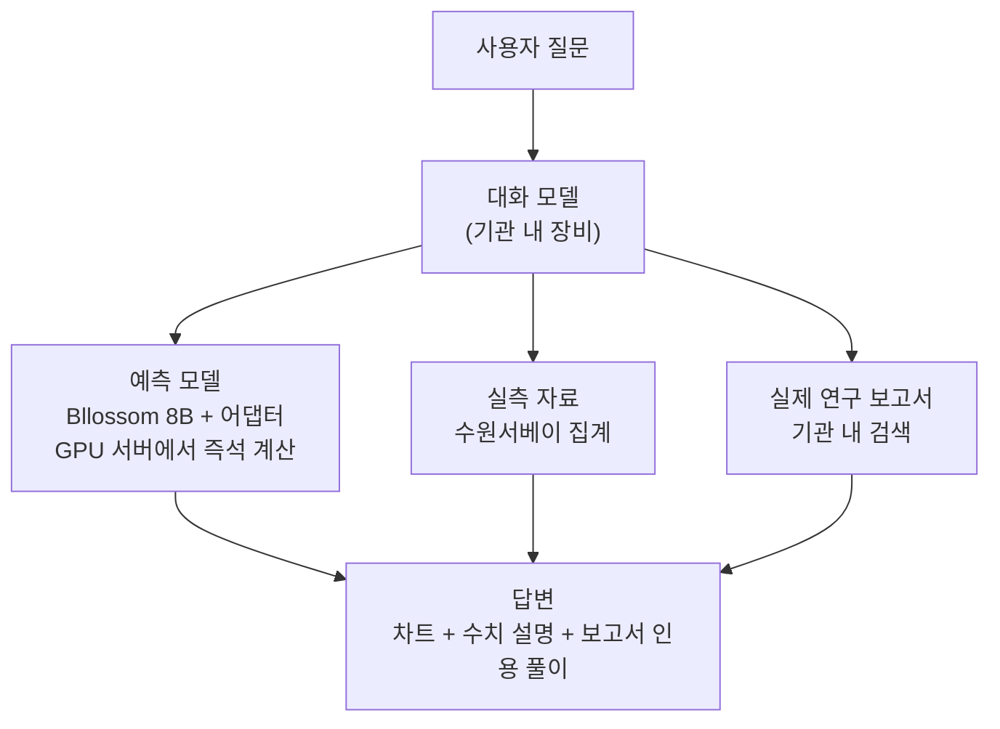
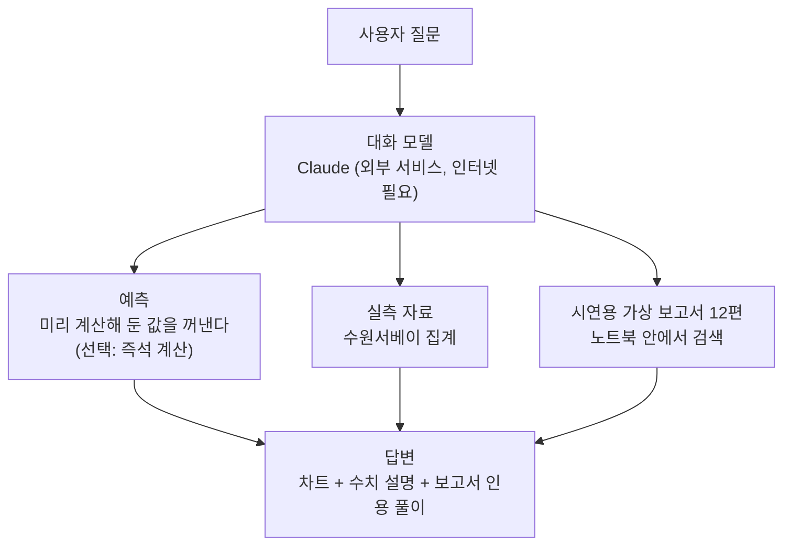

# 수원서베이 응답 예측 챗봇 소개

이 문서는 이 챗봇을 처음 보는 분을 위한 소개입니다. 무엇을 보여 주는 화면인지, 원래는 어떤 구조로 움직이는 것이 바람직한지, 지금은 어떻게 만들어 두었는지, 그래서 어떻게 실행하는지를 차례로 적었습니다. 설치 명령과 설정값 같은 세부 사항은 [README](../README.md)에 있습니다.

## 1. 한마디로

수원서베이로 학습한 언어 모델이 **"이 집단은 이 문항에 이렇게 답할 것이다"** 라고 예측한 결과를, 채팅으로 물어보고 실제 조사 결과와 나란히 볼 수 있게 만든 **시연용 화면**입니다.

실제로 운영하는 서비스가 아닙니다. 실험 결과를 표와 숫자로만 보면 와닿지 않으므로, 질문하고 답을 받는 형태로 바꿔 보여 주려는 것입니다.

## 2. 바탕이 된 실험

- **무엇을 학습했나**: 한국어 언어 모델(Bllossom 8B)에 2023년과 2024년 수원서베이의 집단별 응답 결과를 학습시켰습니다. 모델 전체를 바꾸지 않고 **어댑터**라는 작은 부품만 학습시켜 원래 모델에 끼우는 방식입니다.
- **무엇을 예측했나**: 2025년 조사 결과를 보여 주지 않은 채, 2025년 문항 113개에 각 집단이 어떻게 답할지를 예측하게 했습니다. 그 뒤 실제 2025년 조사 결과와 견주었습니다.
- **예측의 모양**: "평균 몇 점" 하나가 아니라 **응답 분포**, 곧 보기마다 몇 %가 고를지입니다.
- **집단**: 성별, 연령, 주택유형, 점유형태, 고용형태, 통근·통학, 거주기간, 종교의 여덟 속성으로 나눈 33개 집단입니다. 한 번에 속성 하나로만 나눕니다.

### 예시 하나

문항: "한국사회의 최하층을 0으로 하고 최상층을 10으로 한다면 귀하는 본인의 경제·사회적 위치가 어디에 해당된다고 생각하십니까?" (2025년, 점유형태별)

| 집단 | 응답자 수 | 예측 평균 | 실제 평균 |
|---|---|---|---|
| 자가 | 1,930명 | 5.47점 | 5.89점 |
| 전세 | 794명 | 5.41점 | 5.69점 |
| 월세 및 사글세 | 275명 | 5.17점 | 5.04점 |

분포 전체로 잰 오차는 11점 척도에서 약 0.36점입니다. 같은 문항에서 작년(2024년) 조사 결과를 그대로 가져다 쓰면 약 0.44점, 학습시키지 않은 원래 모델에 물으면 약 2.7점 어긋납니다. 화면은 이런 비교를 막대 차트로 보여 줍니다.

### 어댑터 세 개

같은 모델에 서로 다르게 학습시킨 어댑터 세 개를 갈아 끼우며 볼 수 있습니다.

| 어댑터 | 학습 자료 | 확인하려는 것 |
|---|---|---|
| 전체 학습 어댑터 | 2023·2024년 전체 | 다음 해 조사 결과를 얼마나 맞히나 |
| 집단 제외 어댑터 | 7개 집단의 응답을 뺀 것 | 한 번도 보지 못한 집단을 얼마나 맞히나 |
| 문항 제외 어댑터 | 4개 문항을 뺀 것 | 한 번도 보지 못한 문항을 얼마나 맞히나 |

## 3. 질문 하나가 처리되는 과정

"점유형태별로 본인의 경제·사회적 위치를 어떻게 답할지 예측해 줘"라고 물으면 네 가지가 차례로 일어납니다.

1. **질문 이해**: 대화 모델이 어떤 문항을 어떤 속성으로 나눠 달라는 것인지 알아냅니다.
2. **예측과 실측 가져오기**: 그 문항·집단의 예측 분포와 2025년 실제 조사 결과를 가져와 오차를 계산합니다.
3. **참고 문서 찾기**: 그 문항을 다룬 보고서를 찾습니다.
4. **답변**: 차트를 보여 주고, 수치를 말로 설명한 뒤, 보고서 내용을 인용해 풀이를 덧붙입니다.

여기에는 서로 다른 일을 하는 부품 네 개가 있습니다. 이 구분이 이 챗봇을 이해하는 핵심입니다.

| 부품 | 하는 일 | 하지 않는 일 |
|---|---|---|
| 예측 모델 (Bllossom 8B + 어댑터) | 응답 분포를 예측한다 | 문장을 쓰지 않는다. 보고서를 보지 않는다 |
| 실측 자료 (수원서베이 집계) | 예측이 맞았는지 견줄 기준이 된다 | — |
| 대화 모델 | 질문을 이해하고 답변 문장을 쓴다 | 숫자를 스스로 계산하지 않는다. 앱이 계산해 준 숫자를 받아 옮기도록 지시되어 있다 |
| 참고 문서 | 수치를 풀이할 근거가 된다 | 예측에 쓰이지 않는다 |

차트의 숫자는 대화 모델을 거치지 않고 화면에 바로 갑니다. 대화 모델이 문장 속 숫자를 잘못 옮기는 일이 있더라도 차트의 숫자는 달라지지 않습니다. 그래서 문장과 차트가 다르면 차트가 맞습니다.

## 4. 이상적인 구조

실제로 기관에서 쓴다면 모든 부품이 **기관 안의 장비**에서 돌고, 예측은 **질문을 받을 때마다 즉석에서** 계산하는 것이 바람직합니다.



- **예측 모델**이 GPU 서버에 올라가 있어, 어떤 문항·집단이든 그 자리에서 계산합니다. 조사에 없던 **새 문항**을 넣어 "이렇게 물으면 어떻게 답할까"를 미리 보는 데까지 쓸 수 있습니다.
- **대화 모델**도 기관 안에서 돕니다. 질문과 자료가 밖으로 나가지 않습니다.
- **참고 문서**는 연구원이 실제로 낸 보고서입니다. 답변이 실제 보고서의 해당 쪽을 인용합니다.

## 5. 지금 만들어 둔 구조

시연은 GPU가 없는 노트북 한 대로도 할 수 있어야 하므로, 세 부품을 아래처럼 바꿔 두었습니다. 화면과 질문·답변의 흐름은 이상적인 구조와 같습니다.



| 부품 | 이상적인 구조 | 지금 | 이렇게 한 까닭과 그 결과 |
|---|---|---|---|
| 예측 모델 | GPU 서버에서 즉석 계산 | 연구실 GPU 서버에서 **미리 계산해 둔 예측**을 꺼낸다 | GPU 없이 바로 답이 나오고, 실험 보고서의 숫자와 똑같다. 대신 미리 계산한 113개 문항만 볼 수 있다 |
| 대화 모델 | 기관 안의 모델 | 외부 서비스인 Claude | 따로 장비를 두지 않아도 된다. 대신 인터넷과 이용 키가 필요하고, 질문과 집계 수치가 외부 서비스로 전달된다 |
| 참고 문서 | 실제 연구 보고서 | **시연용 가상 보고서** 12편 | 구조를 보여 주기 위한 대역이다. 숫자는 2023·2024년 수원서베이 실제 결과에서 가져왔지만 글은 시연용으로 지은 것이다. 화면에 "시연용 가상 문서"라고 표시된다 |
| 실측 자료 | 수원서베이 집계 | 같다 | 집단별 집계만 들어 있다. 개인 단위 응답은 없다 |
| 문서 검색 | 기관 안에서 검색 | 같다 (노트북 안에서 검색) | — |

덧붙여 둔 장치가 둘 있습니다.

- **인터넷이 끊겨도 시연이 이어지게**: 대화 모델에 닿지 않으면, 처음 화면의 추천 질문은 미리 받아 둔 답변으로 나옵니다. 화면에 "저장된 답변"이라고 표시됩니다. 차트와 참고 문서는 그대로 나옵니다.
- **즉석 계산도 해 볼 수 있게**: 아래 6절의 두 번째·세 번째 방식입니다. 이상적인 구조의 "즉석 계산"을 실제로 돌려 보는 용도입니다.

## 6. 실행 방식

예측을 어디서 가져오느냐에 따라 세 가지 방식이 있고, 설정값 하나(`PREDICT_BACKEND`)로 고릅니다. 화면과 대화는 셋 다 같습니다.

| 방식 | 예측을 가져오는 곳 | 필요한 장비 | 화면 표시 | 언제 쓰나 |
|---|---|---|---|---|
| **조회** (`lookup`, 기본) | 미리 계산해 둔 값 | 보통 노트북 | 사전 계산 | 시연과 발표. 보고서의 숫자와 나란히 보여 줄 때 |
| **실시간** (`live`) | GPU에서 모델을 올려 즉석 계산 | GPU 메모리 16GB 이상 | 실시간 | 이상적인 구조를 그대로 돌려 볼 때. 새 문항 예측 |
| **실시간 · 양자화** (`gguf`) | 모델을 작게 줄여 CPU에서 즉석 계산 | GPU 없이 RAM 8GB 이상 | 실시간 · 양자화 | GPU 없는 PC에서 즉석 계산의 흐름만 돌려 볼 때 |

세 방식의 현재 상태는 다음과 같습니다.

- **조회**: 화면의 모든 값이 실험 결과 원본과 일치하는 것을 확인했습니다. 시연에는 이 방식을 씁니다.
- **실시간**: 만든 PC에 GPU가 없어 **실제 모델로는 아직 돌려 보지 못했습니다.** GPU가 있는 PC에서 점검 프로그램(`live_check`)을 돌려 저장된 예측과 같은 값이 나오는지 먼저 확인해야 합니다.
- **실시간 · 양자화**: GPU 없는 PC에서 실제로 돌아갑니다. 한 장면을 처음 볼 때 집단 수에 따라 40초에서 1분 반쯤 걸립니다. 다만 **값이 저장된 예측과 꽤 다릅니다.** 모델을 줄인 탓인지 다른 원인이 있는지는 가리지 못했습니다. 숫자를 믿고 볼 용도가 아니라 흐름을 보는 용도입니다.

### 가장 간단한 실행 (조회 방식)

Python 3.12와 Node가 깔린 PC에서 저장소를 받은 뒤 아래를 차례로 실행합니다.

```bash
pip install -r requirements.txt          # 필요한 파이썬 패키지
cp .env.example .env                     # 대화 모델 이용 키를 적는 파일 (키가 없어도 추천 질문은 나온다)

cd backend
python -m suwon_chat.build_index         # 예측과 실측 자료를 정리한다 (처음 한 번)
python -m suwon_chat.reports             # 참고 문서를 검색할 수 있게 정리한다 (처음 한 번. 검색용 모델 약 470MB를 내려받는다)

cd ../frontend
npm install && npm run build             # 화면을 만든다 (처음 한 번)

cd ../backend
python -m uvicorn suwon_chat.api:app --port 8000
```

브라우저에서 http://localhost:8000 을 열고, 처음 화면의 추천 질문을 위에서부터 눌러 보면 됩니다.

| 추천 질문 | 보여 주는 것 |
|---|---|
| 기본 예측 | 예측과 실제 조사 결과가 얼마나 겹치나 |
| 작년 값과 비교 | 작년 조사 결과를 그대로 쓰는 것보다 나은가 |
| 못 본 집단 | 한 번도 보지 못한 집단의 예측 |
| 못 본 문항 (잘 되는 경우, 안 되는 경우) | 한 번도 보지 못한 문항의 예측 |
| 할 수 없는 것 | 할 수 없는 질문에 어떻게 답하나 |

실시간 방식과 양자화 방식의 실행 순서, 장비별 주의점은 [README의 "예측을 가져오는 세 가지 방식"](../README.md#예측을-가져오는-세-가지-방식)에 있습니다.

## 7. 할 수 있는 것과 없는 것

할 수 있는 것:

- 2025년 조사 문항 113개에 대해, 여덟 속성 가운데 하나로 나눈 집단별 예측과 실제 결과를 나란히 보기
- 어댑터 세 개를 바꿔 가며 견주기, 작년 조사 결과나 학습 전 모델과 견주기
- 관련 참고 문서를 찾고, 그 내용으로 수치를 풀이하기
- (실시간 방식과 양자화 방식에서) 조사에 없던 새 문항의 예측. 견줄 실제 결과가 없으므로 "실험적"이라고 표시된다

할 수 없는 것. 물으면 할 수 없다고 답합니다.

- 두 속성을 겹친 집단 ("30대 여성")
- 연도에 따른 변화나 앞으로의 전망 ("내년에는?")
- 모델이 왜 그렇게 예측했는지에 대한 설명

개인 단위 응답은 애초에 들어 있지 않습니다. 이 챗봇이 가진 조사 자료는 집단별 집계뿐입니다.

## 8. 용어

| 용어 | 뜻 |
|---|---|
| 응답 분포 | 한 문항에서 보기마다 몇 %가 골랐는지. 이 실험이 예측하는 대상 |
| 실측 | 실제 조사 결과. 여기서는 2025년 수원서베이의 집단별 집계 |
| 어댑터 (LoRA) | 큰 모델은 그대로 두고 따로 학습시켜 끼우는 작은 부품. 갈아 끼우면 같은 모델이 다르게 학습된 것처럼 움직인다 |
| 학습 전 모델 | 어댑터를 끼우지 않은 원래 Bllossom 8B. 학습의 효과를 보기 위한 비교 대상 |
| 오차 | 예측 분포와 실제 분포가 얼마나 다른지. 화면에서는 "11점 척도에서 약 0.36점"처럼 척도의 점수로 바꿔 보여 준다 |
| 대화 모델 | 질문을 이해하고 답변 문장을 쓰는 모델. 예측 모델과는 다른 모델이다 |
| 양자화 | 모델의 숫자를 거칠게 줄여 용량을 작게 만드는 것. 작은 장비에서 돌지만 값이 달라질 수 있다 |
| 사전 계산 · 실시간 | 예측을 미리 계산해 둔 것인지, 질문을 받고 계산한 것인지. 화면의 배지로 구분한다 |
